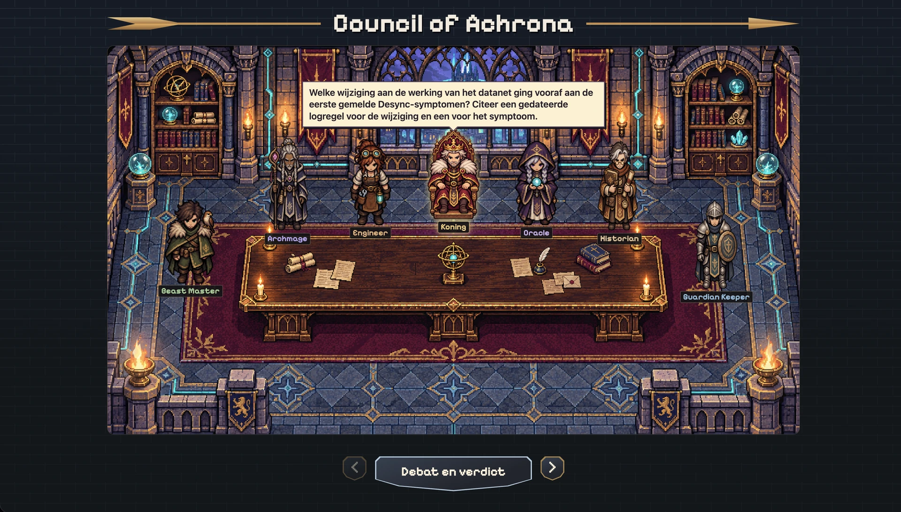
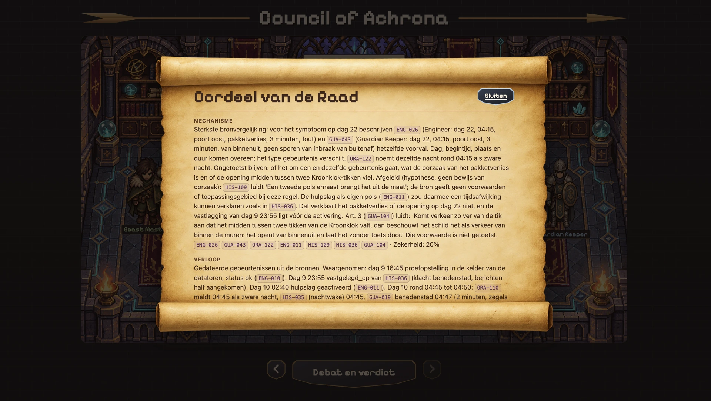

# Vuren — Council of Achrona

Onze inzending voor **Hack The Future 2026, challenge 113** van Roboest. De stad Achrona kampt met de Desync. Berichten komen onvolledig aan, schilden gaan onverwacht open en archieftijden wijken af. We bouwden een raad van AI-agenten die samen uitzoeken welke gebeurtenissen met elkaar samenhangen en welk herstel de bronnen ondersteunen.

## Eindresultaat

In onze einddemo volg je het opgenomen debat van de Koning en zijn raadsleden. Na zeven beurten vergelijkt het verdict twee onafhankelijke meldingen bij de oostpoort op dag 22 om 04:15. Het netwerklogboek meldt drie minuten pakketverlies en de wacht meldt een schildopening van binnenuit van dezelfde duur. Een timingverschil blijft een hypothese omdat de bronnen geen tijdstippen van de Kroonklok-tikken geven. De Raad adviseert de kloktikken te controleren, eerst een kopie van het register te maken en daarna de twee pulsen geleidelijk samen te brengen.

### De raadszaal

### Het oordeel van de Raad

## Hoe we Vuren bouwden

We begonnen met de vaste beurtvolgorde uit de starterkit. Onze eerste debatten leverden waarnemingen op, maar het bleef moeilijk om een patroon aan een technisch mechanisme te koppelen. Daarom bouwden we de vragen rond drie onderdelen van het verdict. Welke ingreep vond plaats, hoe zou die de symptomen kunnen verklaren en wat zien we door de tijd heen?

We implementeerden zes [raadsleden](raadsleden/) op basis van de [rolkaarten](rolkaarten.md). De **Engineer** dateert netwerkwijzigingen en storingen. De **Guardian Keeper** vergelijkt schildregels met wachtrapporten. De **Historian** controleert archieftijden en zoekt historische herstelprocedures. De **Oracle** zoekt patronen in visioenen en de **Beast Master** toetst die aan dierenobservaties. De **Archmage** kan gedateerde metingen van de magische infrastructuur vergelijken.

We gebruikten Python en Microsoft Agent Framework. De specialisten draaien op `achrona` en de Koning op `achrona-groot`, beide via de OpenAI-compatibele API van Roboest. Elk raadslid haalt gegevens op uit zijn eigen kennisbron via MCP. De Koning werkt met wat de raadsleden in het debat inbrengen.

- [**Debat**](council.py) — De Koning kiest na de eerste vraag welke bron een open vraag kan toetsen. We leggen per beurt de keuze, de vraag en de reden vast. Zodra de beschikbare bronnen geen onderbouwde vervolgstap bieden, kan de Koning stoppen binnen het budget van tien beurten.
- [**Verdict**](verdict.py) — De Koning stelt het oordeel en herstelplan op. We controleren de JSON-structuur en de bewijsverwijzingen, en laten de Koning de claims en bijbehorende bronpassages opnieuw beoordelen. Bij problemen krijgt de uitvoer één herstelpoging. Open vragen en onzekerheid blijven zichtbaar.
- [**Validatie**](validate.py) — Een aparte controle toetst de twee JSON-bestanden aan hun schema’s, controleert de run-ID en zoekt de aangehaalde records en bronpassages terug in het debat.
- [**Viewer**](viewer.py) — We bouwden een raadszaal waarin je elke vraag en elk antwoord terugziet. De liveviewer volgt een lopend debat. De [demoviewer](demo-viewer/VIEWER_README.md) speelt een opgeslagen run af zonder nieuwe modelcalls.

De [ingediende debattrace](trace.json) bevat de vragen, redenen, bronraadplegingen en antwoorden. Het [ingediende verdict](verdict.json) bevat de bevindingen, de onderbouwing, het geordende herstelplan en de risico’s.

## Licentie

MIT, zie [LICENSE](LICENSE).
